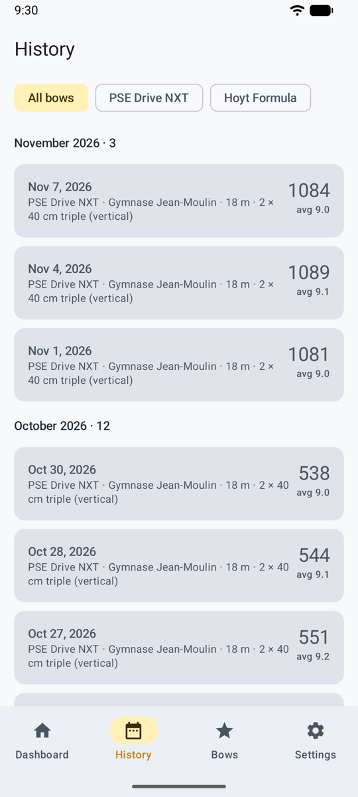
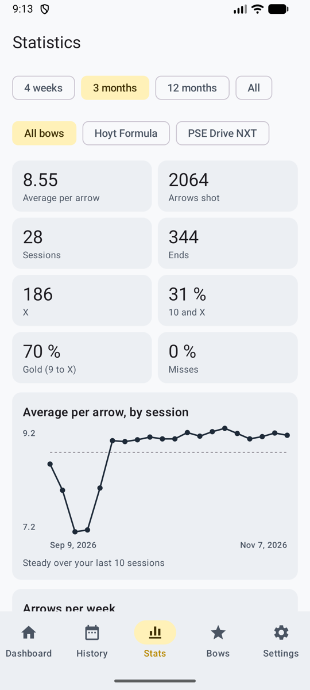

# History and statistics

Every session stays on your phone with its photos. The **History** tab (*Historique*) lists them, and the **Stats** tab shows what matters in training and competition. In game mode, the **trophy wall** shows your level, badges and personal bests, with a link to all your sessions, and the **hearth** your statistics, "by the fire".

<figure markdown>
{ .shot }
<figcaption><b>History</b>, filtered by bow</figcaption>
</figure>
<figure markdown>
{ .shot }
<figcaption><b>Level, volume and trend</b></figcaption>
</figure>
<figure markdown>
{ .shot }
<figcaption><b>Where your arrows group</b></figcaption>
</figure>

## History

- **Dashboard:** sessions, average per arrow, best total, X count and recent sessions.
- **History:** every finished session, by month, filtered by bow. Open one for its scoresheet, its chart and the photo of each end.

## Statistics

For a period (4 weeks to all) and a bow:

- **Average per arrow** and its trend by session, **arrows shot** and **arrows per week** (training volume over 12 weeks).
- Shares of **10 and X**, **gold** (9 to X) and **misses**, and how many arrows land in each ring.
- **Consistency:** your best end, the end-to-end spread (lower is steadier), and the second half of your sessions against the first (fatigue).
- **Where your arrows group:** every arrow the AI placed, on one target, with the group centre (high, low, left or right: handy for sight marks) and the spread. Arrows placed by hand aren't in it, because only the AI measures the target on the photo.
- **Rounds:** for each round you shoot, your best, average and last score.

Only confirmed ends of finished sessions count. To start over, see [Erase data](backup.md#erase-data).
